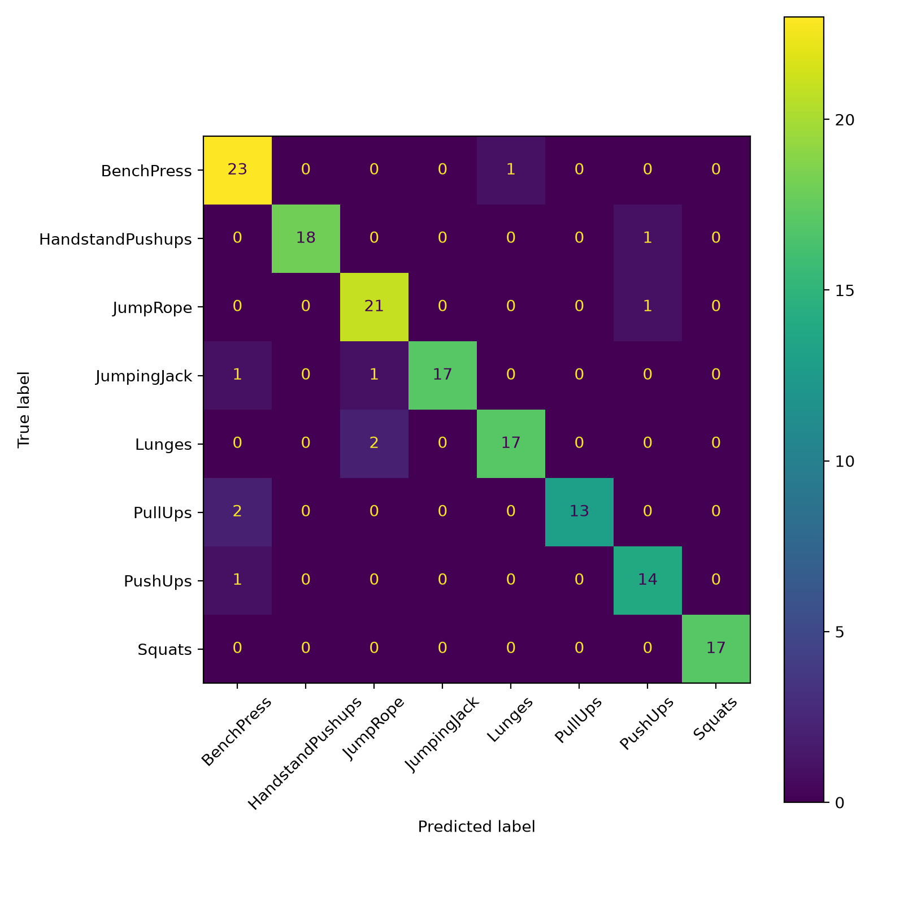
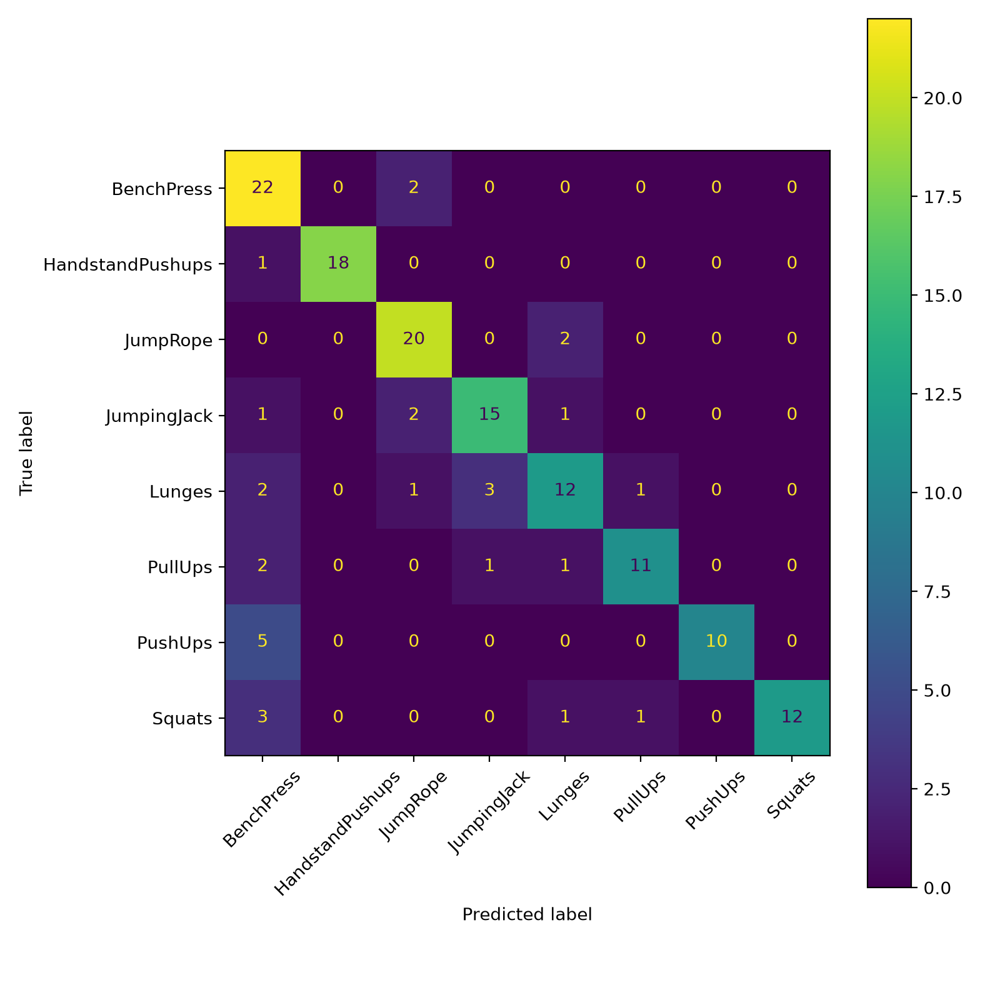

# PoseMotion-Coach

**PoseMotion-Coach** is a real-time computer vision fitness coach that recognizes exercise movements from webcam/video using **MediaPipe Pose**, **LSTM**, and **Transformer sequence models**.

The system extracts full-body pose landmarks, converts movement into temporal keypoint sequences, classifies the exercise, and provides live feedback such as prediction confidence, repetition count, movement stage, pose angles, and basic form guidance.

---

## Why I Built This

Most fitness tracking systems either depend on wearable sensors or only count simple movements. PoseMotion-Coach explores a camera-based approach where a user can perform an exercise in front of a webcam and receive real-time movement recognition and basic coaching feedback.

Instead of training directly on raw video frames, this project uses body pose landmarks. This makes the system lighter, more interpretable, and better suited for real-time inference.

---

## Key Highlights

- Built a real-time pose-based exercise recognition system using webcam input.
- Used **MediaPipe Pose** to extract full-body landmarks from exercise videos.
- Converted each video into **48-frame temporal keypoint sequences**.
- Trained and compared **LSTM** and **Transformer Encoder** models.
- Processed **996 UCF101 exercise videos** across **8 movement classes**.
- Achieved **93% test accuracy** and **0.94 macro-F1** using the LSTM model.
- Added live demo features including:
  - prediction smoothing
  - confidence thresholding
  - rep counting
  - movement stage tracking
  - pose-angle display
  - basic form feedback


## Dataset

This project uses an exercise-focused subset of the **UCF101 action recognition dataset**.

| Class | Videos |
|---|---:|
| BenchPress | 160 |
| HandstandPushups | 128 |
| JumpRope | 144 |
| JumpingJack | 123 |
| Lunges | 127 |
| PullUps | 100 |
| PushUps | 102 |
| Squats | 112 |

**Total videos:** 996

The videos were processed into pose-keypoint sequences using MediaPipe Pose.

---

## Technical Pipeline

```text
Exercise Video / Webcam
        |
        v
MediaPipe Pose Landmark Extraction
        |
        v
33 full-body landmarks per frame
        |
        v
48-frame temporal keypoint sequence
        |
        v
LSTM / Transformer sequence model
        |
        v
Exercise prediction
        |
        v
Confidence, reps, angles, and form feedback
```

---

## Model Results

| Model | Accuracy | Macro F1 |
|---|---:|---:|
| LSTM | 93% | 0.94 |
| Transformer Encoder | 80% | 0.80 |

The LSTM model performed better on this dataset. The Transformer model showed higher confusion between visually similar exercises, likely because the dataset size was relatively small for a Transformer-based approach.

---

## Confusion Matrices

### LSTM Confusion Matrix



### Transformer Confusion Matrix



---

## Live Demo Output

During webcam inference, the system displays real-time information such as:

```text
Prediction: Squats
Confidence: 0.91
Reps: 6
Stage: down
Knee Angle: 82 deg
Feedback: Good depth
```

The live demo uses a sliding window of pose sequences and smooths predictions to reduce flickering between classes.

---

## Live Demo Features

| Feature | Description |
|---|---|
| Exercise prediction | Predicts the current exercise class |
| Confidence thresholding | Filters uncertain predictions |
| Prediction smoothing | Reduces flickering predictions |
| Rep counting | Counts repetitions for supported movements |
| Movement stage tracking | Tracks up/down or open/closed movement phase |
| Pose-angle display | Shows key joint angles |
| Form feedback | Gives simple correction guidance |

---

## Tech Stack

| Area | Tools |
|---|---|
| Programming | Python |
| Computer Vision | OpenCV, MediaPipe Pose |
| Deep Learning | TensorFlow, Keras |
| Models | LSTM, Transformer Encoder |
| Data Processing | NumPy, Pandas |
| Evaluation | scikit-learn, Matplotlib |

---

## Repository Structure

```text
PoseMotion-Coach/
├── src/
│   ├── index_videos.py
│   ├── extract_keypoints.py
│   ├── train.py
│   ├── evaluate.py
│   ├── live_demo.py
│   ├── form_feedback.py
│   ├── models.py
│   ├── pose_utils.py
│   └── dataset.py
├── assets/
│   └── results/
│       ├── lstm_8class_confusion_matrix.png
│       └── transformer_8class_confusion_matrix.png
├── config.yaml
├── requirements.txt
├── .gitignore
└── README.md
```

---

## How to Run

### 1. Create environment

```bash
python3.12 -m venv .venv
source .venv/bin/activate
python -m pip install --upgrade pip
python -m pip install -r requirements.txt
```

If MediaPipe gives compatibility issues, install this version:

```bash
python -m pip install mediapipe==0.10.14
```

---

### 2. Prepare dataset

Place exercise videos in this format:

```text
data/raw/
├── BenchPress/
├── HandstandPushups/
├── JumpRope/
├── JumpingJack/
├── Lunges/
├── PullUps/
├── PushUps/
└── Squats/
```

---

### 3. Create video manifest

```bash
python -m src.index_videos \
  --data-dir data/raw \
  --out data/manifest.csv
```

---

### 4. Extract pose keypoints

```bash
python -m src.extract_keypoints \
  --manifest data/manifest.csv \
  --out-dir data/processed \
  --seq-len 48
```

---

### 5. Train LSTM model

```bash
python -m src.train \
  --processed-manifest data/processed/processed_manifest.csv \
  --model lstm \
  --epochs 30 \
  --out runs/lstm_8class
```

---

### 6. Train Transformer model

```bash
python -m src.train \
  --processed-manifest data/processed/processed_manifest.csv \
  --model transformer \
  --epochs 30 \
  --out runs/transformer_8class
```

---

### 7. Evaluate model

```bash
python -m src.evaluate \
  --model-path runs/lstm_8class/best_model.keras \
  --test-manifest runs/lstm_8class/test_manifest.csv \
  --out runs/lstm_8class_eval
```

---

### 8. Run live webcam demo

```bash
python -m src.live_demo \
  --model-path runs/lstm_8class/best_model.keras \
  --labels runs/lstm_8class/labels.json \
  --seq-len 48 \
  --smooth 5 \
  --confidence-threshold 0.60 \
  --coach \
  --show-angles \
  --camera 0
```

If the webcam does not open, try changing the camera index:

```bash
--camera 1
```

---

## Notes

The dataset, processed keypoint files, virtual environment, and trained model weights are not included in this repository because of file size.

Ignored local files include:

```text
.venv/
data/raw/
data/processed/
runs/
*.keras
*.npy
```

The repository contains the full training, evaluation, and inference pipeline along with result images.

---

## Future Improvements

- Add plank and sit-up classes using custom collected videos.
- Improve Transformer performance using more data and augmentation.
- Convert the LSTM model to TensorFlow Lite for lightweight edge deployment.
- Add a Streamlit or Gradio web interface.
- Add workout session tracking and progress reports.
- Add more detailed exercise-specific form correction logic.
- Add real-time demo video or GIF to the README.

---

## Resume Summary

Built a real-time AI fitness coach using MediaPipe Pose to extract full-body landmarks from 996 UCF101 exercise videos and convert movements into 48-frame temporal keypoint sequences. Trained and compared LSTM and Transformer models across 8 exercise classes, achieving 93% test accuracy and 0.94 macro-F1 with LSTM. Developed a live webcam demo with confidence thresholding, prediction smoothing, repetition counting, pose-angle display, and form feedback.
